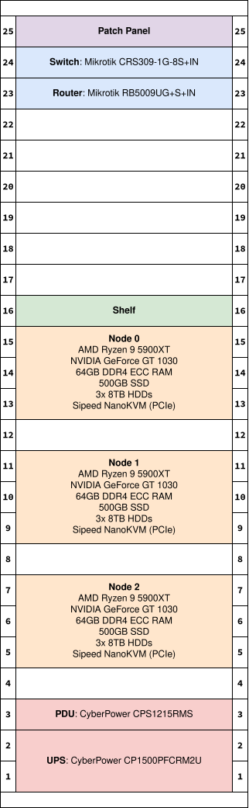

# Hardware

## Overview

Axolotl Cloud has a 25U rack with a network switch, a router, 3 server nodes, a PDU, and a UPS.

The network switch is a [Mikrotik CRS309-1G-8S+IN](https://mikrotik.com/product/crs309_1g_8s_in), which has eight 10Gb SFP+ ports and one 1Gb Ethernet port.

The router is a [Mikrotik RB5009UG+S+IN](https://mikrotik.com/product/rb5009ug_s_in), which has one 10Gb SFP+ port, one 2.5Gb Ethernet port, and seven 1Gb Ethernet ports. It essentially acts as a router-on-a-stick. Learn more [here](./networking/index.md).

Each of the 3 server nodes contains the following:

- AMD Ryzen 9 5900XT (16c, 32t; 4.8GHz max boost)
- NVIDIA GeForce GT 1030
- 64GB of DDR4 ECC RAM
- 500GB boot SSD
- 3x 8TB HDDs
- [Sipeed NanoKVM (PCIe)](https://wiki.sipeed.com/hardware/en/kvm/NanoKVM_PCIe/introduction.html)

This makes for a total of **96 vCPUs**, **192GB of memory**, and **72TB of storage**.

The PDU is a [CyberPower CPS1215RMS](https://www.cyberpowersystems.com/product/surge/rackbar/cps1215rms/) and the UPS is a [CyberPower CP1500PFCRM2U](https://www.cyberpowersystems.com/product/ups/pfc-sinewave/cp1500pfcrm2u/), which can handle up to 1500VA/1000W with an abysmal 216Wh capacity. We also have an [Anker SOLIX S2000](https://www.ankersolix.com/s2000), which is a 2kWh power station that can output up to 1500W with a <10ms UPS transfer time.

## Server Rack

<figure markdown="span">
    { width="420" }
</figure>

## Anker SOLIX S2000 vs. CyberPower UPS

The S2000's 2010Wh LiFePO4 battery has over 9x the capacity of the CyberPower UPS, which has a 216Wh lead-acid battery. At our typical load of 500W, the S2000 is about 96% efficient, which makes for 1930Wh of usable energy. On the other hand, lead-acid batteries lose significant capacity under heavy load, so the CyberPower UPS can only deliver a truly abysmal 85Wh at 500W based on its rated runtime. That's only about 10 minutes...

In comparison, the S2000 is able to provide nearly 4 hours with a 500W load. This means that it provides over 22x the amount of energy/runtime for only 1.8x the price (as of October 2026).

Not only that, but the S2000's battery should also last significantly longer. Its LiFePO4 battery is rated for 6000 cycles before dropping to 80% of its capacity, and Anker estimates a 15-year lifespan with a 5-year warranty. The CyberPower UPS' lead-acid batteries, on the other hand, only last 3-5 years on average and even less with frequent use or heat.

TL;DR - don't buy a lead-acid UPS.
