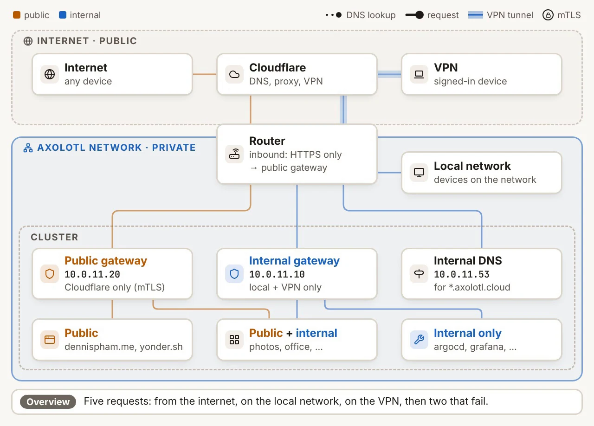
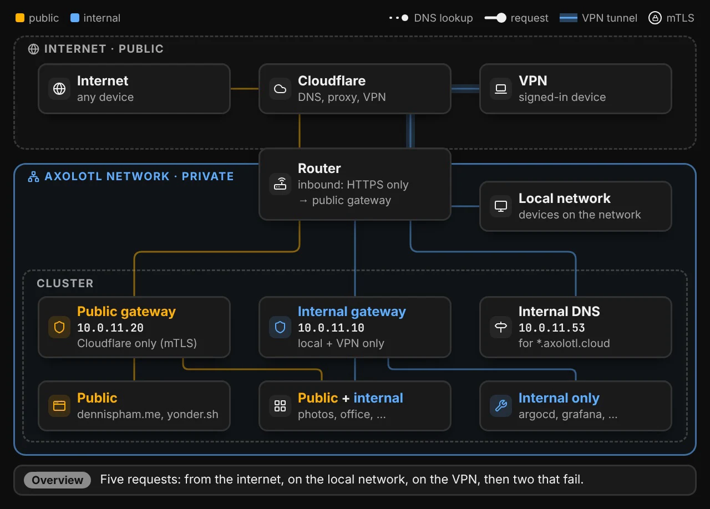

# Accessing Services

With [split-horizon DNS](https://en.wikipedia.org/wiki/Split-horizon_DNS), each service we host has a single hostname (e.g. `photos.axolotl.cloud`) no matter where it is accessed from. There are two ingress gateways in the cluster:

- The public ingress gateway receives traffic from the internet, which is proxied through Cloudflare.
- The internal ingress gateway receives traffic from devices on our network and devices connected to our VPN.

<figure markdown="span">
    { .only-light }
    { .only-dark }
</figure>

Services can be accessed through the public gateway, the internal gateway, or both, depending on the configuration:

| Access              | Examples                    |
| ------------------- | --------------------------- |
| Public              | dennispham.me, yonder.sh    |
| Public and internal | Immich, Jellyfin, OpenCloud |
| Internal only       | Argo CD, Ceph, Grafana      |

Clients are sent to the right gateway with split-horizon DNS. Public DNS records for our domains point to Cloudflare, while devices on our network and VPN resolve the same hostnames to the internal ingress gateway.

## From the Internet

<figure markdown="span">
    <video class="only-light" loop muted playsinline preload="metadata" poster="/assets/accessing-services/internet-light.webp" width="1280" height="918">
        <source src="/assets/accessing-services/internet-light.mp4" type="video/mp4">
    </video>
    <video class="only-dark" loop muted playsinline preload="metadata" poster="/assets/accessing-services/internet-dark.webp" width="1280" height="918">
        <source src="/assets/accessing-services/internet-dark.mp4" type="video/mp4">
    </video>
</figure>

When a client on the internet looks up one of our hostnames, public DNS points it to Cloudflare, which proxies the request to our router. The router then forwards the request to the public ingress gateway, which enforces that the request originated from Cloudflare via mTLS[^1]. The gateway finally routes the request to the service with the traffic transparently encrypted with mTLS by our service mesh.

## From Our Network

<figure markdown="span">
    <video class="only-light" loop muted playsinline preload="metadata" poster="/assets/accessing-services/local-network-light.webp" width="1280" height="918">
        <source src="/assets/accessing-services/local-network-light.mp4" type="video/mp4">
    </video>
    <video class="only-dark" loop muted playsinline preload="metadata" poster="/assets/accessing-services/local-network-dark.webp" width="1280" height="918">
        <source src="/assets/accessing-services/local-network-dark.mp4" type="video/mp4">
    </video>
</figure>

Devices on our network use the router for DNS (because of DHCP). It forwards queries for `*.axolotl.cloud` to our internal DNS service in the cluster, which answers with the IP address of the internal ingress gateway for apps that can be accessed internally. Requests then go straight to the internal ingress gateway and never leave our network.

## From the VPN

<figure markdown="span">
    <video class="only-light" loop muted playsinline preload="metadata" poster="/assets/accessing-services/vpn-light.webp" width="1280" height="918">
        <source src="/assets/accessing-services/vpn-light.mp4" type="video/mp4">
    </video>
    <video class="only-dark" loop muted playsinline preload="metadata" poster="/assets/accessing-services/vpn-dark.webp" width="1280" height="918">
        <source src="/assets/accessing-services/vpn-dark.mp4" type="video/mp4">
    </video>
</figure>

Devices running the Cloudflare One VPN client connect to Cloudflare, and Cloudflare Tunnel connects Cloudflare to our router[^1]. This allows traffic from these devices into our private network through the VPN and tunnel. Only traffic destined for our private CIDR (10.0.0.0/8) is routed through the tunnel. This includes DNS queries for our domains, which [Local Domain Fallback](https://developers.cloudflare.com/cloudflare-one/team-and-resources/devices/cloudflare-one-client/configure/route-traffic/local-domains/) sends to our router instead of Cloudflare's resolver, meaning that devices on the VPN get the same answers as devices on our network and reach the same internal ingress gateway through the tunnel.

## Internal-Only Apps

<figure markdown="span">
    <video class="only-light" loop muted playsinline preload="metadata" poster="/assets/accessing-services/internal-only-light.webp" width="1280" height="918">
        <source src="/assets/accessing-services/internal-only-light.mp4" type="video/mp4">
    </video>
    <video class="only-dark" loop muted playsinline preload="metadata" poster="/assets/accessing-services/internal-only-dark.webp" width="1280" height="918">
        <source src="/assets/accessing-services/internal-only-dark.mp4" type="video/mp4">
    </video>
</figure>

Internal-only apps, such as Argo CD or Grafana, do not have routes on the public ingress gateway. Their hostnames still resolve to Cloudflare from the internet, but the public ingress gateway has nowhere to route these requests and returns a 404.

## Direct Requests

<figure markdown="span">
    <video class="only-light" loop muted playsinline preload="metadata" poster="/assets/accessing-services/direct-https-light.webp" width="1280" height="918">
        <source src="/assets/accessing-services/direct-https-light.mp4" type="video/mp4">
    </video>
    <video class="only-dark" loop muted playsinline preload="metadata" poster="/assets/accessing-services/direct-https-dark.webp" width="1280" height="918">
        <source src="/assets/accessing-services/direct-https-dark.mp4" type="video/mp4">
    </video>
</figure>

The router only forwards HTTPS traffic from the internet, and only to the public ingress gateway. If a request is sent to our public IP address directly instead of through Cloudflare, it reaches the public ingress gateway without Cloudflare's client certificate and is rejected.

## More on Split-Horizon DNS

Our internal DNS service is a second deployment of [CoreDNS](https://coredns.io) in the cluster with the [k8s_gateway](https://github.com/k8s-gateway/k8s_gateway) plugin, separate from the cluster DNS that pods use to resolve Kubernetes services. The plugin watches the routes attached to the internal ingress gateway and answers queries for their hostnames with the gateway's IP address, so we do not have to manage internal DNS records by hand. All other queries are forwarded to Cloudflare's 1.1.1.1.

For hostnames with internal routes, queries for `AAAA` and `HTTPS` records return empty answers instead of falling through to our public DNS records. Otherwise, clients on our network could pick up Cloudflare's IP addresses from those records and attempt to connect through the public gateway instead.

[^1]: Learn more about our Cloudflare setup [here](./index.md#cloudflare).
