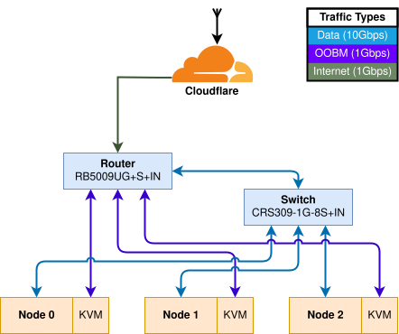

# Networking

## Overview

With the [Mikrotik RB5009UG+S+IN](https://mikrotik.com/product/rb5009ug_s_in) router and the [Mikrotik CRS309-1G-8S+IN](https://mikrotik.com/product/crs309_1g_8s_in) switch, the router essentially acts as a [router-on-a-stick](https://www.networkacademy.io/ccna/ethernet/router-on-a-stick).

There is one 10Gb link between the router and switch, with the port configured as a trunk on the switch. This allows for inter-VLAN routing. This is the optimal configuration with an L2 switch, as it leaves the routing to the hardware in the router instead of being done in software on the switch, resulting in better performance.

Currently, all networking is IPv4 only, with a future goal of migrating to IPv6.

## Cluster Networking

Each of the 3 nodes in the cluster has a 10Gb link to the switch, and is BGP peered with the router. In the cluster, we use [Cilium](https://cilium.io/) for advertising routes to the router with BGP so that Kubernetes `LoadBalancer` services can be dynamically assigned IP addresses.

Each node also has a KVM over IP module for out-of-band management (OOBM), which is connected directly to the router with a 1Gb link.

<figure markdown="span">
    { width="600" }
</figure>

## Cloudflare

We use various services provided by Cloudflare, including 1.1.1.1, Access, Pages, Tunnels, WARP, and of course, their proxy.

### Access & Proxy w/ mTLS

Cloudflare is set up to proxy traffic to our cluster's public ingress gateway with mTLS[^1]. This means that a client certificate will be presented by Cloudflare on every request, which we can verify to ensure that we only accept traffic from Cloudflare. This is extremely important for Cloudflare Access so that an actor is not able to bypass the Cloudflare network and send requests directly to our router.

### Tunnel & VPN

Another important part of our networking infrastructure is Cloudflare Tunnel, which connects our network to Cloudflare. Together with the Cloudflare One client, it works as our VPN, allowing us to connect to internal services on our private network from anywhere. The tunnel's connector, `cloudflared`, runs in a [container](https://manual.mikrotik.com/docs/containers/) directly on the router itself so that node failure does not affect connectivity to our OOBM.

[^1]: Learn more about how requests reach the cluster [here](./accessing-services.md).
